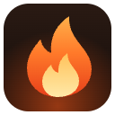
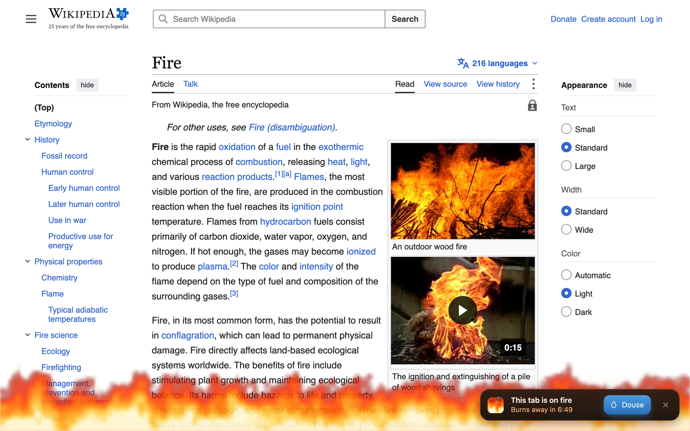
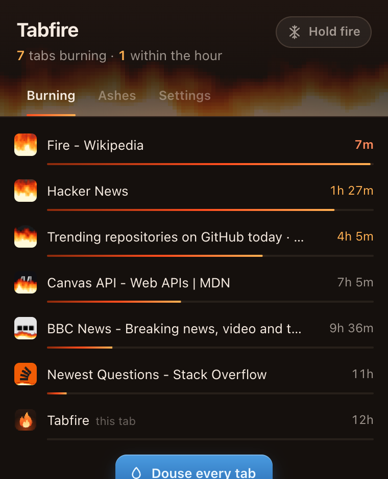
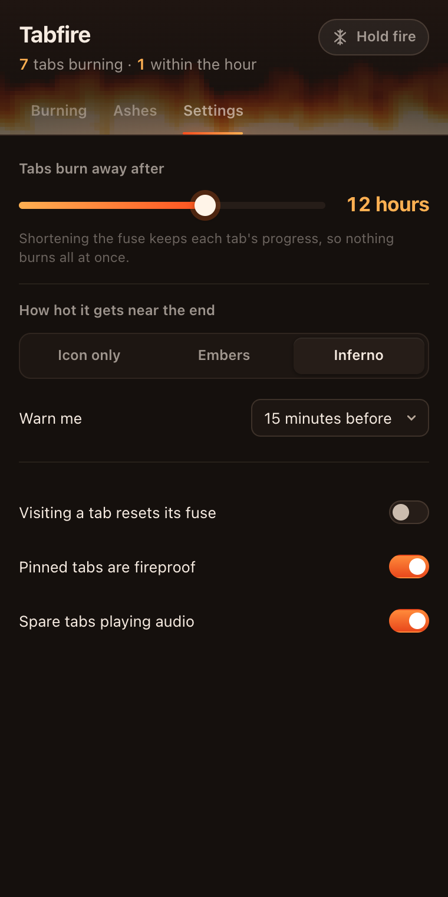

  

<h1 align="center">Tabfire</h1>

Your tabs slowly catch fire. Close them, or they burn away on their own.

  

Every tab you open starts a fuse (12 hours by default). Its icon in the tab strip slowly fills with flames, climbing from the bottom and charring as it goes. In the last few minutes the page itself starts to glow and a little card counts down. Ignore it, and the tab burns away.

Changed your mind? Burned tabs land in **Ashes**, one click to bring them back.

## Features

- **Burning tab icons.** Flames are drawn into the site's real favicon, right in Chrome's tab strip.
- **A warning before it burns.** Embers along the bottom of the page and a countdown card with a **Douse** button. Dousing resets the fuse with a puff of steam.
- **Inferno mode** for real flames climbing up the page near the end.
- **Ashes.** Every burned tab is kept so you can rekindle it.
- **Hold fire.** Freeze every fuse (they turn icy blue) while you're in the middle of something.
- **Douse shortcut.** `Alt+Shift+D` resets the tab you're on.
- **Sensible safety rules.** Pinned tabs are fireproof, tabs playing audio wait until they're quiet, the tab you're looking at never burns, and it never closes your last tab.
- **Fuses pause while Chrome is closed**, so you don't come back to an empty window.

  
  

## Settings

| Setting | Default |
| --- | --- |
| Tabs burn away after | 12 hours (15 minutes to 1 week) |
| How hot it gets | Embers (or Icon only, or Inferno) |
| Warn me | 15 minutes before |
| Visiting a tab resets its fuse | Off |
| Pinned tabs are fireproof | On |
| Spare tabs playing audio | On |
| Never burn the tab I'm looking at | On |
| Show 🔥 in tab titles | Off |
| Fuse keeps burning while Chrome is closed | Off |
| Fireproof sites | None |

Shortening the fuse keeps each tab's progress, so nothing burns all at once.

## Install

1. Download this repo (**Code → Download ZIP**, then unzip) or `git clone https://github.com/apewithllm/tabfire`.
2. Open `chrome://extensions` and turn on **Developer mode**.
3. Click **Load unpacked** and pick the `tabfire` folder.

Works in Chrome, Brave, Edge, Arc and other Chromium browsers. Tabs that were already open catch fire right away.

## Privacy

Tabfire has no server, no analytics and no account. Everything (tab timers, settings, ashes) stays in your browser's local extension storage. It needs access to all sites only to draw flames on each page's icon and show the countdown card.

## Notes

- Browser pages like `chrome://settings` and the New Tab page can't be drawn on, so their icons don't burn, but they still close on schedule.
- Fireproof a site by adding its domain in Settings (`mail.google.com`, `figma.com`, ...). Subdomains count.

## How it works

- `background.js` keeps one record per tab (when it caught fire, its URL) and checks every 30 seconds for anything past its fuse. After a browser restart, tabs are matched back to their records by URL.
- `fire.js` is a tiny noise-based flame renderer shared by the tab icons, the page flames and the popup.
- `content.js` composites the flames over the page's own favicon and handles the glow and countdown card inside a closed shadow root, so it can't clash with the site's styles.

No build step, no dependencies.

## License

MIT
